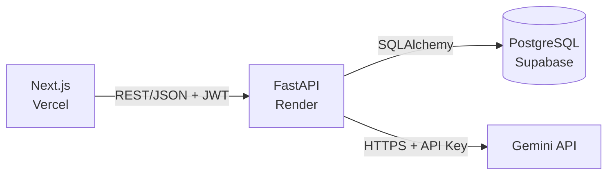

# Assistente de Cozinha — a base técnica aplicada a um problema real

> **Você está na branch `feature/cooking-idea`, que nunca é mergeada na `main`.**
> A `main` é o **mínimo técnico**: login e um chat com LLM, com camadas separadas, testes,
> Docker e credenciais protegidas. Esta branch usa exatamente essa base para resolver um
> problema de verdade. As duas ficam lado a lado de propósito — para comparar.
> Correções da `main` entram aqui por merge da `main`, nunca o contrário.

Quem cozinha em casa não lembra o que tem, deixa comida vencer, descobre no meio da receita
que falta um ingrediente, mantém a lista de compras num papel solto — e, quando pergunta a
uma IA o que fazer para o jantar, recebe uma sugestão que não tem como fazer.

O assistente junta tudo num ciclo: a **despensa** alimenta as **receitas** ("você tem 7 de
9 ingredientes"), o que falta vai para a **lista de compras**, e a compra finalizada volta
para a despensa. Um **Chef com IA** trabalha sobre esses dados — sugere o que cozinhar com o
que tem, interpreta "comprei 2 kg de arroz e uma dúzia de ovos", escreve receitas e sugere
compras. Na hora de cozinhar, um **modo cozinha** mostra o passo a passo com timers.

O problema, a solução, as decisões de engenharia e um roteiro de demonstração estão em
[`docs/assistente-de-cozinha.md`](docs/assistente-de-cozinha.md). A especificação original
do projeto base continua em [`docs/projeto-chat-ia-liga.md`](docs/projeto-chat-ia-liga.md).

## Arquitetura



O frontend não fala com o banco nem com o LLM. Toda regra de negócio e toda credencial
sensível vivem no backend, em variável de ambiente — nunca no cliente, nunca no
repositório. Detalhes, camadas e o fluxo de uma requisição em
[`docs/arquitetura.md`](docs/arquitetura.md).

## Stack

| Camada | Tecnologia |
|---|---|
| Frontend | Next.js (App Router) |
| Backend | FastAPI + Pydantic |
| ORM | SQLAlchemy |
| Banco | PostgreSQL (Supabase) |
| LLM | Gemini API (Google AI Studio) |
| Containers | Docker + Docker Compose |
| CI/CD | GitHub Actions |
| Testes | pytest + coleção Postman |
| Deploy | Vercel (frontend) · Render (backend) |

## Documentação

| Documento | Conteúdo |
|---|---|
| [`docs/assistente-de-cozinha.md`](docs/assistente-de-cozinha.md) | Problema, solução, decisões e roteiro de demonstração desta branch |
| [`docs/projeto-chat-ia-liga.md`](docs/projeto-chat-ia-liga.md) | Especificação e fases do projeto base |
| [`docs/arquitetura.md`](docs/arquitetura.md) | Componentes, camadas e fluxo de dados |
| [`docs/contrato-api.md`](docs/contrato-api.md) | Endpoints, payloads e códigos de erro |
| [`docs/modelo-de-dados.md`](docs/modelo-de-dados.md) | Tabelas `users` e `messages` |
| [`CONTRIBUTING.md`](CONTRIBUTING.md) | Branches, commits e Pull Requests |
| [`postman/`](postman) | Contrato executável da API |

## Como rodar

```bash
git clone git@github.com:PUCTech/base-project-2026.git
cd base-project-2026
cp .env.example .env    # preencha os valores; .env nunca é commitado

docker compose up --build

# Em outro terminal: oito receitas clássicas para a aplicação não começar vazia
docker compose exec backend python -m app.seed
```

- API: <http://localhost:8000> · Swagger UI: <http://localhost:8000/docs>
- Banco: `localhost:5433` (para inspecionar com psql ou DBeaver)
- Fotos das receitas: volume `media-data`, servidas em `/media`

Para o frontend, em outro terminal:

```bash
cd frontend
npm install
cp .env.local.example .env.local
npm run dev      # http://localhost:3000
```

Gere um segredo forte para o JWT e cole em `JWT_SECRET_KEY`:

```bash
openssl rand -hex 32
```

| Comando | Efeito |
|---|---|
| `docker compose up --build` | Sobe banco e API; reconstrói a imagem |
| `docker compose logs -f backend` | Acompanha os logs da API |
| `docker compose down` | Derruba tudo, **mantendo** os dados |
| `docker compose down -v` | Derruba tudo e **apaga** o banco e as fotos |
| `docker compose exec backend python -m app.seed` | Cria as receitas de demonstração (não duplica) |

O backend só inicia depois que o healthcheck do Postgres passa. Sem essa espera, ele
tentaria conectar enquanto o banco ainda está inicializando e morreria no boot — o clássico
"funciona no segundo `up`".

A chave da Gemini sai de [Google AI Studio](https://aistudio.google.com/apikey) e vai em
`GEMINI_API_KEY` — **no `.env` do backend**, nunca numa variável `NEXT_PUBLIC_*`: tudo que
leva esse prefixo é embutido no bundle e fica legível no navegador.

No plano gratuito o Gemini aceita poucas requisições por minuto, e o assistente usa IA em
quatro telas. Quando a cota acaba, a API responde `429` com `Retry-After` e a tela mostra
quanto esperar.

## Estrutura

```
.
├── frontend/           # Next.js (App Router)
├── backend/
│   ├── app/
│   │   ├── routers/    # rotas HTTP: auth, despensa, receitas, compras, IA, chat
│   │   ├── schemas/    # validação Pydantic
│   │   ├── models/     # tabelas SQLAlchemy
│   │   ├── services/   # regra de negócio (ingredientes, IA da cozinha, fotos, LLM...)
│   │   └── seed.py     # receitas de demonstração
│   ├── tests/          # pytest
│   └── Dockerfile
├── docker-compose.yml
├── .github/workflows/  # CI/CD
├── postman/            # coleção exportada
└── docs/               # especificação e diagramas
```

## Progresso das fases

| # | Fase | Status |
|:-:|---|:-:|
| 1 | Setup e contrato de API | ✅ |
| 2 | Backend core | ✅ |
| 3 | Autenticação e testes | ✅ |
| 4 | Dockerização | ✅ |
| 5 | Frontend | ✅ |
| 6 | Integração com o LLM | ✅ |
| 7 | CI/CD e Deploy | ⬜ adiada |
| 8 | Revisão final | ⬜ adiada |
| — | Assistente de cozinha (esta branch) | ✅ |

## Contribuindo

Uma branch `feature/*` por fase, commits no padrão Conventional Commits, um Pull Request
por fase. O processo está em [`CONTRIBUTING.md`](CONTRIBUTING.md) — e é seguido à risca de
propósito: o histórico deste repositório é parte do material didático.
