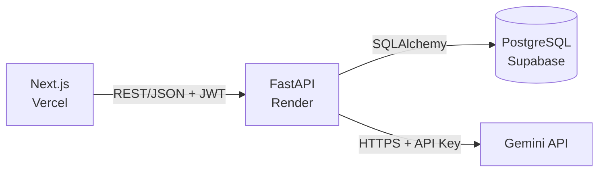

# Chat com IA — projeto full stack de referência

Aplicação web com login e um chat integrado a um LLM. O escopo funcional é
propositalmente pequeno — cadastrar, entrar, perguntar, receber a resposta — porque o
objetivo não é a funcionalidade: é servir de **projeto de referência de engenharia de
software**, com camadas separadas, histórico de Git exemplar, containerização, CI/CD e
proteção de credenciais, para depois virar material didático.

A especificação completa está em
[`docs/projeto-chat-ia-liga.md`](docs/projeto-chat-ia-liga.md) e é a fonte da verdade do
projeto.

## Arquitetura



O frontend não fala com o banco nem com o LLM. Toda regra de negócio e toda credencial
sensível vivem no backend, em variável de ambiente — nunca no cliente, nunca no
repositório. Detalhes, camadas e o fluxo de uma requisição em
[`docs/arquitetura.md`](docs/arquitetura.md).

## Stack

| Camada | Tecnologia |
|---|---|
| Frontend | Next.js (App Router) |
| Backend | FastAPI + Pydantic |
| ORM | SQLAlchemy |
| Banco | PostgreSQL (Supabase) |
| LLM | Gemini API (Google AI Studio) |
| Containers | Docker + Docker Compose |
| CI/CD | GitHub Actions |
| Testes | pytest + coleção Postman |
| Deploy | Vercel (frontend) · Render (backend) |

## Documentação

| Documento | Conteúdo |
|---|---|
| [`docs/projeto-chat-ia-liga.md`](docs/projeto-chat-ia-liga.md) | Especificação e fases do projeto |
| [`docs/arquitetura.md`](docs/arquitetura.md) | Componentes, camadas e fluxo de dados |
| [`docs/contrato-api.md`](docs/contrato-api.md) | Endpoints, payloads e códigos de erro |
| [`docs/modelo-de-dados.md`](docs/modelo-de-dados.md) | Tabelas `users` e `messages` |
| [`CONTRIBUTING.md`](CONTRIBUTING.md) | Branches, commits e Pull Requests |
| [`postman/`](postman) | Contrato executável da API |

## Como rodar

```bash
git clone git@github.com:PUCTech/base-project-2026.git
cd base-project-2026
cp .env.example .env    # preencha os valores; .env nunca é commitado

docker compose up --build
```

- API: <http://localhost:8000> · Swagger UI: <http://localhost:8000/docs>
- Banco: `localhost:5433` (para inspecionar com psql ou DBeaver)

Para o frontend, em outro terminal:

```bash
cd frontend
npm install
cp .env.local.example .env.local
npm run dev      # http://localhost:3000
```

Gere um segredo forte para o JWT e cole em `JWT_SECRET_KEY`:

```bash
openssl rand -hex 32
```

| Comando | Efeito |
|---|---|
| `docker compose up --build` | Sobe banco e API; reconstrói a imagem |
| `docker compose logs -f backend` | Acompanha os logs da API |
| `docker compose down` | Derruba tudo, **mantendo** os dados |
| `docker compose down -v` | Derruba tudo e **apaga** o banco |

O backend só inicia depois que o healthcheck do Postgres passa. Sem essa espera, ele
tentaria conectar enquanto o banco ainda está inicializando e morreria no boot — o clássico
"funciona no segundo `up`".

A chave da Gemini sai de [Google AI Studio](https://aistudio.google.com/apikey) e vai em
`GEMINI_API_KEY` — **no `.env` do backend**, nunca numa variável `NEXT_PUBLIC_*`: tudo que
leva esse prefixo é embutido no bundle e fica legível no navegador.

## Estrutura

```
.
├── frontend/           # Next.js (App Router)
├── backend/
│   ├── app/
│   │   ├── routers/    # rotas HTTP
│   │   ├── schemas/    # validação Pydantic
│   │   ├── models/     # tabelas SQLAlchemy
│   │   └── services/   # regra de negócio (hash, JWT, LLM)
│   ├── tests/          # pytest
│   └── Dockerfile
├── docker-compose.yml
├── .github/workflows/  # CI/CD
├── postman/            # coleção exportada
└── docs/               # especificação e diagramas
```

## Progresso das fases

| # | Fase | Status |
|:-:|---|:-:|
| 1 | Setup e contrato de API | ✅ |
| 2 | Backend core | ✅ |
| 3 | Autenticação e testes | ✅ |
| 4 | Dockerização | ✅ |
| 5 | Frontend | ✅ |
| 6 | Integração com o LLM | ✅ |
| 7 | CI/CD e Deploy | ⬜ adiada |
| 8 | Revisão final | ⬜ adiada |

## Contribuindo

Uma branch `feature/*` por fase, commits no padrão Conventional Commits, um Pull Request
por fase. O processo está em [`CONTRIBUTING.md`](CONTRIBUTING.md) — e é seguido à risca de
propósito: o histórico deste repositório é parte do material didático.
