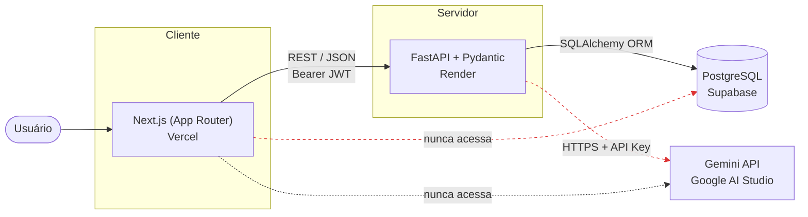
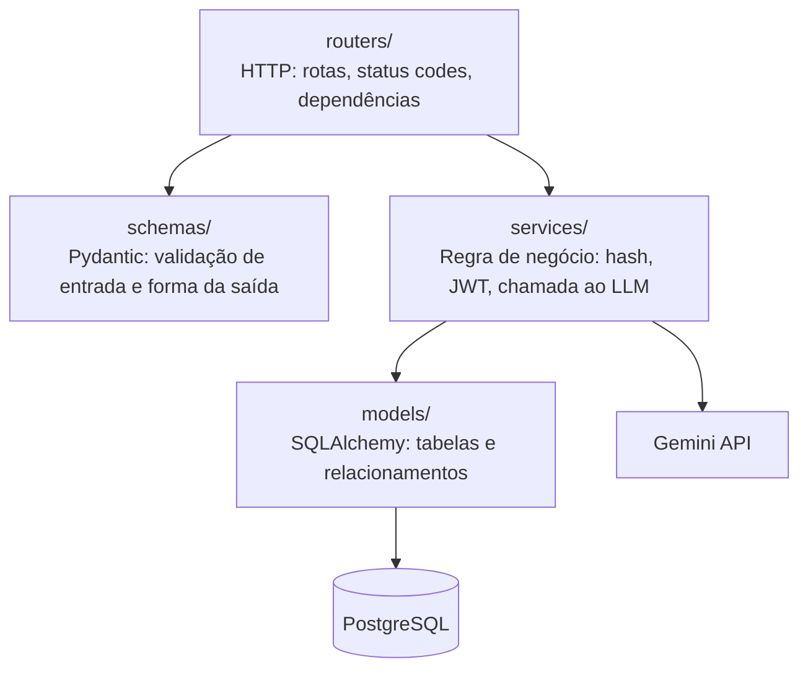
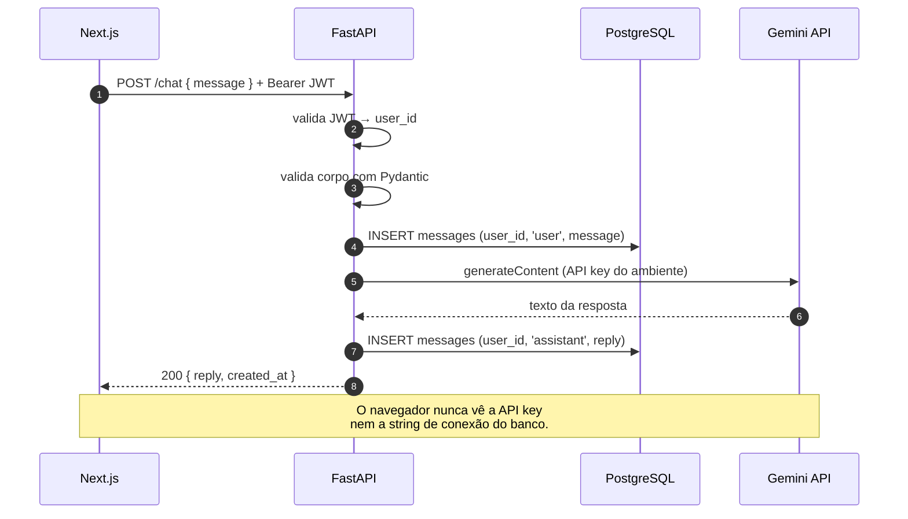

# Arquitetura

## Visão de componentes

A regra que sustenta o desenho: **o frontend não fala com o banco nem com o LLM**. Toda
credencial sensível — chave da Gemini, string de conexão do Postgres, segredo do JWT —
existe apenas como variável de ambiente no backend. Qualquer valor entregue ao navegador
deve ser tratado como público, porque é exatamente isso que ele é.

## Camadas do backend

| Camada | Responsabilidade | Não faz |
|---|---|---|
| `routers/` | Traduzir HTTP ↔ Python: rota, status code, autenticação | regra de negócio, SQL |
| `schemas/` | Validar a entrada e definir o formato da resposta | acesso a banco |
| `services/` | Hash de senha, emissão/validação de JWT, chamada ao LLM | conhecer `Request`/`Response` |
| `models/` | Mapear tabelas e relacionamentos | regra de negócio |

O ganho prático dessa separação: trocar o provedor de LLM mexe em um arquivo de
`services/`, e nenhum router, schema ou model precisa mudar.

## Fluxo de uma pergunta no chat

## Hospedagem gratuita — e o que cada escolha custa

| Serviço | Plataforma | Limitação relevante do plano free |
|---|---|---|
| Banco | Supabase | 500 MB; projeto pausa após ~1 semana sem atividade |
| Backend | Render | A instância **dorme** após ~15 min ociosa; a próxima requisição leva 30–60 s |
| Frontend | Vercel | Suficiente para o escopo; sem limitação prática aqui |

O Supabase resolve o banco, mas **não** hospeda a API: suas Edge Functions rodam em
Deno/TypeScript, não em Python. Daí o backend ficar no Render.

O cold start do Render não é um defeito a esconder — é o gancho para explicar, na
demonstração, por que a primeira requisição depois da ociosidade demora: o contêiner foi
desligado e precisa subir do zero. O frontend precisa lidar com isso (timeout generoso e
estado de carregamento honesto) em vez de fingir que a rede é sempre rápida.
