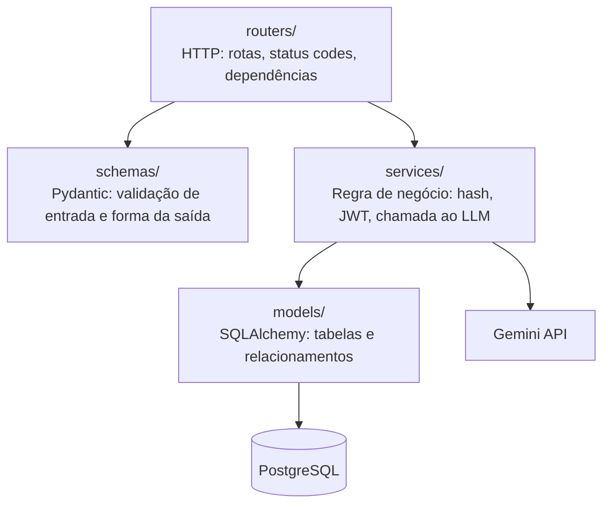
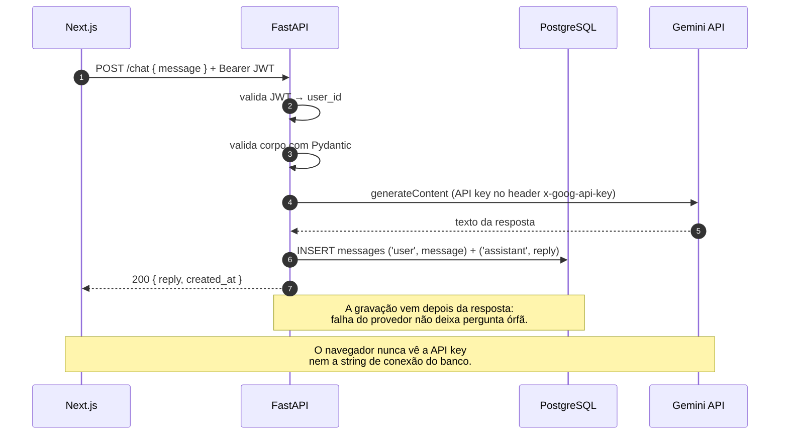
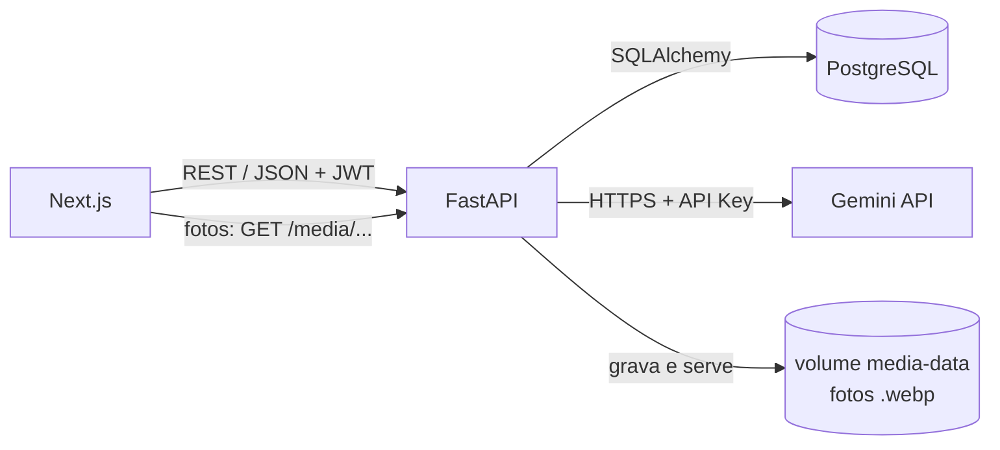
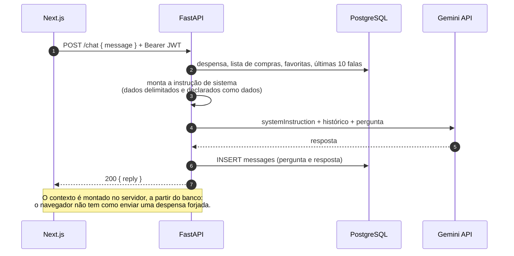
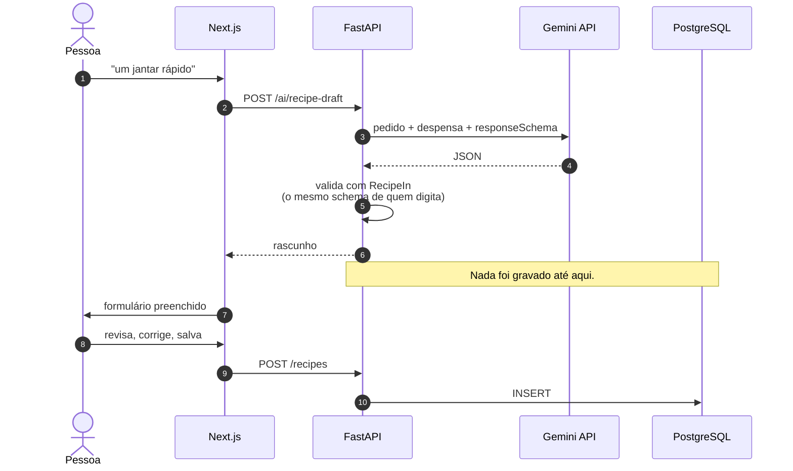

# Arquitetura

## Visão de componentes

A regra que sustenta o desenho: **o frontend não fala com o banco nem com o LLM**. Toda
credencial sensível — chave da Gemini, string de conexão do Postgres, segredo do JWT —
existe apenas como variável de ambiente no backend. Qualquer valor entregue ao navegador
deve ser tratado como público, porque é exatamente isso que ele é.

## Camadas do backend

| Camada | Responsabilidade | Não faz |
|---|---|---|
| `routers/` | Traduzir HTTP ↔ Python: rota, status code, autenticação | regra de negócio, SQL |
| `schemas/` | Validar a entrada e definir o formato da resposta | acesso a banco |
| `services/` | Hash de senha, emissão/validação de JWT, chamada ao LLM | conhecer `Request`/`Response` |
| `models/` | Mapear tabelas e relacionamentos | regra de negócio |

O ganho prático dessa separação: trocar o provedor de LLM mexe em um arquivo de
`services/`, e nenhum router, schema ou model precisa mudar.

## Fluxo de uma pergunta no chat

## Hospedagem gratuita — e o que cada escolha custa

| Serviço | Plataforma | Limitação relevante do plano free |
|---|---|---|
| Banco | Supabase | 500 MB; projeto pausa após ~1 semana sem atividade |
| Backend | Render | A instância **dorme** após ~15 min ociosa; a próxima requisição leva 30–60 s |
| Frontend | Vercel | Suficiente para o escopo; sem limitação prática aqui |

O Supabase resolve o banco, mas **não** hospeda a API: suas Edge Functions rodam em
Deno/TypeScript, não em Python. Daí o backend ficar no Render.

O cold start do Render não é um defeito a esconder — é o gancho para explicar, na
demonstração, por que a primeira requisição depois da ociosidade demora: o contêiner foi
desligado e precisa subir do zero. O frontend precisa lidar com isso (timeout generoso e
estado de carregamento honesto) em vez de fingir que a rede é sempre rápida.

---

# Assistente de cozinha

A branch `feature/cooking-idea` mantém o desenho acima e acrescenta um componente: o volume
onde ficam as fotos das receitas.

## Os serviços novos

| Módulo | Responsabilidade | Não sabe de |
|---|---|---|
| `services/ingredients.py` | Normalizar nomes, converter unidades, calcular o que falta | banco, HTTP |
| `services/pantry.py`, `shopping.py`, `recipes.py`, `recipe_social.py` | Regras de negócio de cada recurso | HTTP |
| `services/recipe_views.py` | Montar a resposta para quem vê: "tem X de Y", favorita, nota | HTTP |
| `services/storage.py` | Validar, reprocessar, gravar e apagar fotos | HTTP, banco |
| `services/kitchen_ai.py` | Contexto da cozinha, prompts e validação das respostas da IA | HTTP, formato da API do provedor |
| `services/llm.py` | Falar com o Gemini: chave, retentativa, histórico, JSON | cozinha |
| `routers/llm_errors.py` | Traduzir as falhas do LLM em status HTTP, igual para todas as rotas | — |

A fronteira entre `kitchen_ai.py` e `llm.py` é a mesma da `main`, agora sob mais carga: trocar
o Gemini por outro provedor continua mexendo só em `llm.py`, embora agora existam quatro
funcionalidades de IA em vez de uma.

## Chat com o contexto da cozinha

## A IA propõe, a pessoa decide

O mesmo padrão vale para o cadastro rápido da despensa (`/ai/pantry-parse` → revisão →
`POST /pantry/batch`) e para as sugestões de compra (`/ai/shopping-suggestions` → escolha →
`POST /shopping-list`).
