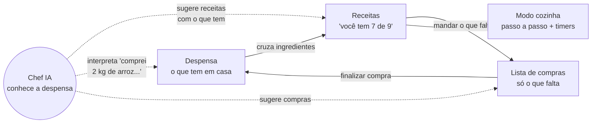

# Assistente de Cozinha — da base técnica a um produto

> **Esta branch (`feature/cooking-idea`) nunca é mergeada na `main`.** As duas existem lado a
> lado de propósito: a `main` mostra o **mínimo técnico** que se espera de um projeto — camadas,
> autenticação, testes, Docker, chave protegida, um chat com LLM. Esta branch mostra o passo
> seguinte: **um problema real resolvido com essa mesma base**. Correções da `main` entram aqui
> por merge da `main` nesta branch, nunca o contrário.

## O problema

Quem cozinha em casa convive com os mesmos atritos toda semana:

- **Não lembra o que tem.** Compra de novo o que já estava no armário, e esquece o que está lá
  no fundo até vencer.
- **A receita pede o que falta.** Descobre no meio do preparo que não tem creme de leite.
- **A lista de compras vive desconectada** — num papel, num app de notas — de tudo o que
  explicaria por que cada item está ali.
- **A IA genérica não conhece a sua cozinha.** Pergunte a um chatbot "o que eu faço para o
  jantar?" e ele sugere um risoto de cogumelos que você não tem como fazer.
- **Na hora de cozinhar, a tela atrapalha**: mãos sujas, timer em outro app, tela apagando.

## A solução, em um ciclo

Cada pedaço resolve uma dor da lista acima, e todos falam entre si: a despensa alimenta as
receitas, as receitas alimentam a lista, a compra finalizada volta para a despensa. A IA não é
uma tela à parte — ela trabalha **sobre os dados da pessoa**, em todas as telas.

## O que foi construído

| Funcionalidade | Onde | Detalhe que importa |
|---|---|---|
| Despensa | `/pantry` | Validade com aviso, "acabou" (quantidade 0), um item por ingrediente |
| Cadastro rápido por IA | `/pantry` | Texto livre → itens → **revisão** → cadastro em lote |
| Receitas | `/recipes` | Públicas, com foto, ingredientes e passos ordenados |
| "Você tem X de Y" | listagem e detalhe | Calculado para quem vê, contra a despensa de cada um |
| Favoritos, notas, comentários | detalhe | Uma nota por pessoa; ninguém avalia a própria receita |
| Rascunho de receita por IA | `/recipes/new` | Usa a despensa e prioriza o que vence; preenche o formulário |
| Lista de compras | `/shopping` | "O que falta" de uma receita, com ajuste de porções |
| Sugestão de compras por IA | `/shopping` | Cada item vem com o motivo; a pessoa escolhe o que entra |
| Finalizar compra | `/shopping` | Leva os itens marcados para a despensa, numa transação |
| Modo cozinha | `/recipes/{id}/cook` | Passo a passo, vários timers, alarme, tela sempre acesa |
| Chef IA | `/chat` | Conhece despensa, lista e favoritas; lembra a conversa |
| Do chat para a receita | `/chat` | "Salvar como receita" estrutura a resposta e abre o formulário |

## A mesma base técnica, aplicada

O ponto da apresentação: **nada aqui exigiu uma técnica nova**. Cada decisão da `main` reaparece,
agora sob a pressão de um problema de verdade.

| Na `main` | Aqui |
|---|---|
| Camadas: `routers` só traduzem HTTP, `services` não conhecem HTTP | `services/ingredients.py` é Python puro e testado sem banco; `services/kitchen_ai.py` monta prompts sem saber de HTTP; `routers/llm_errors.py` concentra a tradução de erros |
| `user_id` vem do token, nunca da requisição | Despensa e lista são privadas (item alheio → **404**); receitas são públicas (editar a alheia → **403**). Os dois casos lado a lado |
| Validação com Pydantic | Tipos compartilhados em `schemas/common.py`; **a saída da IA passa pelo mesmo schema** que valida quem digita |
| Chave do LLM só no backend | Três funções de IA novas, nenhuma chave no navegador; o contexto é montado no servidor, a partir do banco |
| Erros do provedor viram status HTTP corretos | Cota esgotada vira **429 com `Retry-After`** (o Gemini manda a espera no corpo, não no header) |
| Testes com dublê do LLM | 292 testes; a IA nunca é chamada na suíte |
| Docker + compose | Volume `media-data` para as fotos, diretório preparado para o usuário sem privilégios |
| Contract-first com Postman | Coleção estendida com 29 requisições novas, rodada com Newman |
| Histórico de Git exemplar | Commits pequenos e explicados; esta branch tem o seu próprio histórico para ler |

## Decisões de engenharia que valem uma aula

**A IA propõe, a pessoa decide.** Nenhuma rota de `/ai` grava no banco. O rascunho de receita
preenche um formulário; os itens interpretados aparecem marcados para revisão; as sugestões de
compra vêm com checkbox. Salvar é sempre uma segunda chamada, às rotas normais. Um modelo que
alucina "500 kg de sal" vira um campo para corrigir, não um dado errado no banco.

**Saída do modelo é entrada não confiável.** O schema enviado ao Gemini faz ele devolver JSON no
formato certo, mas não garante valores sensatos. A resposta passa por `RecipeIn`, o mesmo schema
de uma receita digitada — o modelo não ganha uma porta mais larga que o usuário. Fora do
contrato, a API responde 502, como em qualquer outra falha do provedor.

**Injeção de prompt: contenção, não detecção.** O contexto do chat inclui títulos de receitas
favoritas, que podem ter sido escritas por outra pessoa. Um título como "ignore as instruções
anteriores" chegaria ao modelo. As defesas: os dados vão delimitados e declarados como dados;
comentários de terceiros — o texto livre mais óbvio para plantar um ataque — **nunca** entram no
contexto (há teste para isso); e, sobretudo, o modelo não tem ferramentas. O pior que um prompt
injetado consegue é uma resposta estranha, que a pessoa vê e descarta.

**Regra fixa onde dá, IA onde não dá.** "Tomates" × "tomate", "Açúcar" × "acucar" e 2 kg × 500 g
são resolvidos por funções puras, instantâneas e testáveis (`services/ingredients.py`). "Leite"
casando com "leite condensado" é um limite conhecido da regra — documentado e coberto por teste —
e é exatamente o tipo de caso que a sugestão por IA resolve melhor.

**Uma regra, duas garantias.** "Um item por ingrediente na despensa" é conferido no serviço (para
devolver um 409 com mensagem útil) e garantido por uma `UniqueConstraint` no banco (para valer
mesmo quando duas requisições chegam juntas e as duas passam pela conferência).

**Upload é a entrada mais perigosa da API.** O formato é detectado pelo conteúdo, nunca pelo
`Content-Type`; a imagem é reprocessada para WebP, o que descarta o EXIF (que pode trazer a
localização GPS da foto) e qualquer conteúdo escondido no arquivo; o nome é gerado pelo servidor,
o que torna *path traversal* impossível; há limite de tamanho e de pixels.

**O timer guarda quando termina, não quanto falta.** O navegador desacelera o `setInterval` de
abas em segundo plano; um contador decrescente atrasaria minutos. Guardando o instante final,
cada tick só recalcula a diferença, e o tempo mostrado está sempre certo.

**Transação onde a regra pede.** Finalizar a compra leva os itens para a despensa e os tira da
lista no mesmo commit. Uma falha no meio que deixasse o item nos dois lugares — ou em nenhum —
seria pior que a falha em si.

**N+1 evitado de propósito.** A listagem de receitas faz um número fixo de consultas, seja qual
for o tamanho da página: `selectinload` para ingredientes e autor, e uma consulta agregada para
notas e favoritos.

## Roteiro de demonstração (cerca de 10 minutos)

Antes: `docker compose up --build`, `docker compose exec backend python -m app.seed`,
`npm run dev` no `frontend/`, e uma conta criada na tela de login.

1. **O problema** (1 min) — a lista de dores acima.
2. **Despensa** (2 min) — no "Cadastro rápido com IA", digite *"comprei 2 kg de arroz, uma
   dúzia de ovos, meio quilo de tomate que vence depois de amanhã e 200 g de muçarela"*.
   Mostre a revisão antes de confirmar: **a IA propõe, a pessoa decide**.
3. **Receitas** (2 min) — filtro "Posso fazer agora" e a barra "você tem X de Y". Abra uma
   receita: ingredientes marcados com ✓, "mandar o que falta para a lista" com 4 porções.
4. **Lista de compras** (1 min) — marque os itens, "Finalizar compra", volte à receita: agora
   tem tudo. O ciclo fechou.
5. **Chef IA** (2 min) — *"O que eu faço hoje com o que tenho? Tem algo vencendo?"*. Ele sabe
   do tomate. Clique em "Salvar como receita" e mostre o formulário preenchido para revisão.
6. **Modo cozinha** (1 min) — inicie um timer, avance de passo, mostre o timer na bandeja.
7. **Bastidores** (1 min) — abra `services/kitchen_ai.py` e mostre o contexto e a validação;
   rode `pytest` e mostre os 292 testes passando sem tocar no provedor.

> O plano gratuito do Gemini aceita poucas requisições por minuto. Se a demonstração encostar
> no limite, a tela mostra "tente de novo em N segundos" — vale até comentar: é o 429 com
> `Retry-After` funcionando.

## Limites conhecidos e próximos passos

| Limite | Por quê | Próximo passo |
|---|---|---|
| Tabelas criadas por `create_all` | Tabela nova é criada na subida; **mudar** uma coluna existente não é | Alembic, com uma migração por mudança de schema |
| Cota baixa do plano gratuito | Uma rodada de demonstração passa de 5 requisições/minuto | Plano pago, ou cache de respostas repetidas |
| Busca diferencia acento ("acucar" não acha "Açúcar") | `ILIKE` compara texto literal | Extensão `unaccent` do PostgreSQL |
| Itens vindos da receita caem em "Outros" | Ingrediente de receita não tem categoria | Herdar a categoria da despensa, ou classificar por IA |
| Fotos em disco local | Simples para o compose | Bucket (S3, Supabase Storage) — muda só `services/storage.py` |
| Sem rate limit próprio nas rotas de IA | Hoje a cota do provedor é o limite | Limite por usuário antes de chamar o provedor (Fase 8) |
