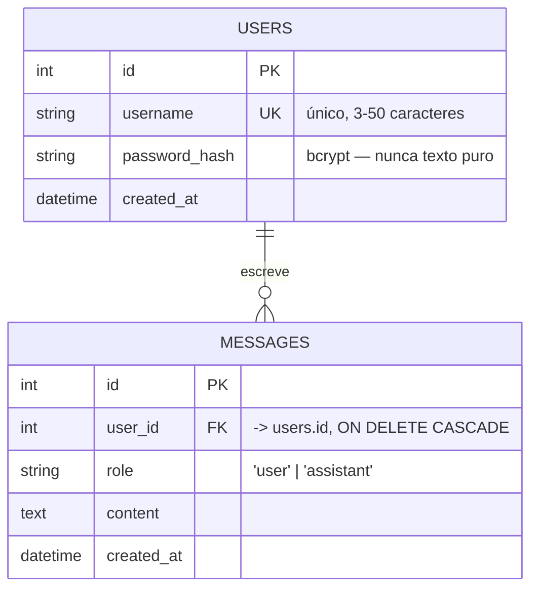
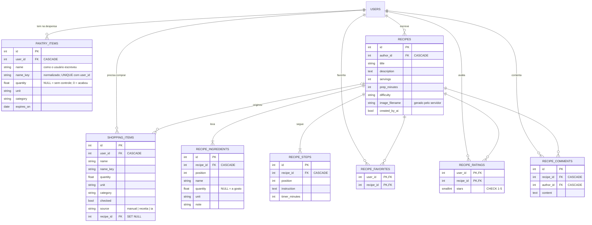

# Modelo de dados

Banco: **PostgreSQL**. Acesso via **SQLAlchemy ORM** — o backend nunca monta SQL por
concatenação de string, o que elimina a superfície mais comum de SQL injection.

## Tabela `users`

| Coluna | Tipo | Restrições | Observação |
|---|---|---|---|
| `id` | `INTEGER` | PK, autoincremento | |
| `username` | `VARCHAR(50)` | `NOT NULL`, `UNIQUE`, indexado | login do usuário |
| `password_hash` | `VARCHAR(255)` | `NOT NULL` | hash bcrypt; a senha original nunca é armazenada nem logada |
| `created_at` | `TIMESTAMP` | `NOT NULL`, default `now()` | |

## Tabela `messages`

| Coluna | Tipo | Restrições | Observação |
|---|---|---|---|
| `id` | `INTEGER` | PK, autoincremento | |
| `user_id` | `INTEGER` | `NOT NULL`, FK → `users.id`, `ON DELETE CASCADE`, indexado | dono da mensagem |
| `role` | `VARCHAR(16)` | `NOT NULL`, ∈ {`user`, `assistant`} | quem produziu o conteúdo |
| `content` | `TEXT` | `NOT NULL` | pergunta do usuário ou resposta do LLM |
| `created_at` | `TIMESTAMP` | `NOT NULL`, default `now()`, indexado | ordenação cronológica |

### Por que duas linhas por interação, e não uma linha `pergunta`/`resposta`?

Cada chamada ao `POST /chat` grava **duas** linhas: uma com `role='user'` (a pergunta) e
outra com `role='assistant'` (a resposta). Esse formato é o mesmo que as APIs de LLM
esperam receber como histórico, então a extensão opcional de "histórico de conversas"
(seção 7 do plano) vira um `SELECT ... ORDER BY created_at` direto, sem remodelagem.

## Escopo

Não há tabela de sessões: a sessão é carregada no próprio **JWT**, que é assinado pelo
backend e validado a cada requisição (Fase 3). Não há tabela de conversas/threads — todas
as mensagens de um usuário formam uma única linha do tempo, o que basta para o escopo
definido no plano.

---

# Assistente de cozinha

Tabelas da branch `feature/cooking-idea`. `users` e `messages` não mudam: o assistente só
acrescenta tabelas, o que permite ao `create_all` da subida criá-las num banco que já existia.

Todas as tabelas têm `created_at`; as que são editadas têm também `updated_at`.

## Decisões de modelagem

**`name` e `name_key`.** O nome é guardado duas vezes: como a pessoa escreveu ("Tomates
Italianos"), para exibir, e normalizado ("tomate italiano"), para comparar. Com a forma
normalizada numa coluna, conferir se um item já existe é uma igualdade indexável, e não uma
normalização recalculada em cada linha a cada consulta.

**Um item por ingrediente na despensa.** `UNIQUE (user_id, name_key)`. O serviço confere antes
de gravar, para devolver um `409` com mensagem útil; a constraint garante a regra mesmo quando
duas requisições chegam juntas e as duas passam pela conferência.

**`NULL` e `0` querem dizer coisas diferentes.** Em `pantry_items.quantity`, `NULL` é "tenho,
mas não controlo quanto" (sal, azeite) e `0` é "acabou" — o item fica cadastrado para lembrar
de comprar. Em `recipe_ingredients.quantity`, `NULL` é "a gosto".

**`FLOAT` e não `NUMERIC`.** É quantidade de cozinha, não dinheiro: arredondar 0,1 g não
prejudica ninguém, e `FLOAT` evita converter `Decimal` em toda a aplicação.

**Ordem explícita.** Ingredientes e passos têm `position`. O banco não garante a ordem das
linhas, e numa receita a ordem é informação.

**Chave primária composta onde a regra é "um por pessoa".** `recipe_favorites` e
`recipe_ratings` usam `(user_id, recipe_id)` como chave: favoritar duas vezes ou dar duas notas
à mesma receita é impossível no próprio banco, e a escrita vira um *upsert* natural.

**A faixa da nota é validada duas vezes.** O Pydantic barra `stars` fora de 1–5 na API; o
`CHECK` protege o dado contra qualquer outro caminho de escrita — um script, uma migração, um
`INSERT` manual.

**A média não é guardada.** `avg_rating` e `rating_count` são calculados numa consulta agregada,
para a página inteira de uma vez. Guardar seria mais rápido de ler, mas exigiria manter os
números sincronizados a cada nota, e um contador dessincronizado é um bug silencioso.

**`CASCADE` em quase tudo, `SET NULL` num lugar só.** Apagar a conta apaga despensa, lista,
receitas, notas e comentários. Mas apagar uma receita **não** tira da lista de compras os itens
que vieram dela (`shopping_items.recipe_id` vira `NULL`): a pessoa ainda pode querer comprá-los.

**Fotos fora do banco.** `recipes.image_filename` guarda só o nome do arquivo, que é gerado pelo
servidor (`<uuid>.webp`). O arquivo mora no volume `media-data`; o banco não é lugar de binário.
