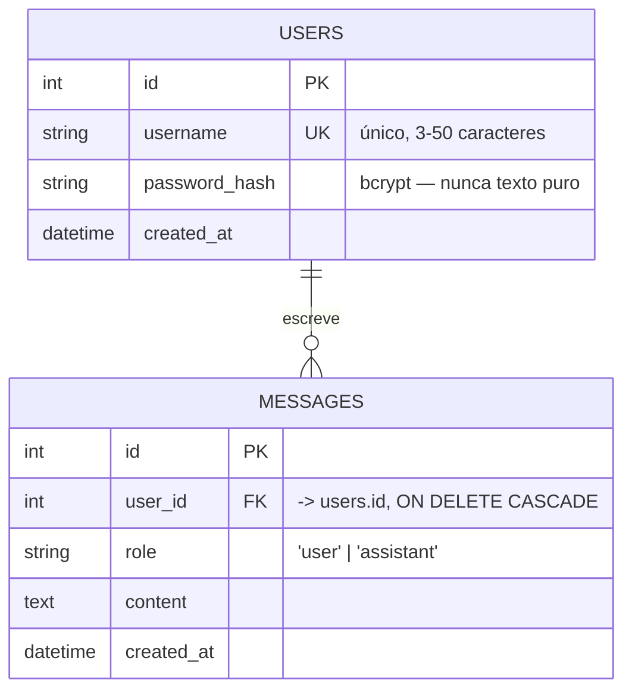

# Modelo de dados

Banco: **PostgreSQL**. Acesso via **SQLAlchemy ORM** — o backend nunca monta SQL por
concatenação de string, o que elimina a superfície mais comum de SQL injection.

## Tabela `users`

| Coluna | Tipo | Restrições | Observação |
|---|---|---|---|
| `id` | `INTEGER` | PK, autoincremento | |
| `username` | `VARCHAR(50)` | `NOT NULL`, `UNIQUE`, indexado | login do usuário |
| `password_hash` | `VARCHAR(255)` | `NOT NULL` | hash bcrypt; a senha original nunca é armazenada nem logada |
| `created_at` | `TIMESTAMP` | `NOT NULL`, default `now()` | |

## Tabela `messages`

| Coluna | Tipo | Restrições | Observação |
|---|---|---|---|
| `id` | `INTEGER` | PK, autoincremento | |
| `user_id` | `INTEGER` | `NOT NULL`, FK → `users.id`, `ON DELETE CASCADE`, indexado | dono da mensagem |
| `role` | `VARCHAR(16)` | `NOT NULL`, ∈ {`user`, `assistant`} | quem produziu o conteúdo |
| `content` | `TEXT` | `NOT NULL` | pergunta do usuário ou resposta do LLM |
| `created_at` | `TIMESTAMP` | `NOT NULL`, default `now()`, indexado | ordenação cronológica |

### Por que duas linhas por interação, e não uma linha `pergunta`/`resposta`?

Cada chamada ao `POST /chat` grava **duas** linhas: uma com `role='user'` (a pergunta) e
outra com `role='assistant'` (a resposta). Esse formato é o mesmo que as APIs de LLM
esperam receber como histórico, então a extensão opcional de "histórico de conversas"
(seção 7 do plano) vira um `SELECT ... ORDER BY created_at` direto, sem remodelagem.

## Escopo

Não há tabela de sessões: a sessão é carregada no próprio **JWT**, que é assinado pelo
backend e validado a cada requisição (Fase 3). Não há tabela de conversas/threads — todas
as mensagens de um usuário formam uma única linha do tempo, o que basta para o escopo
definido no plano.
