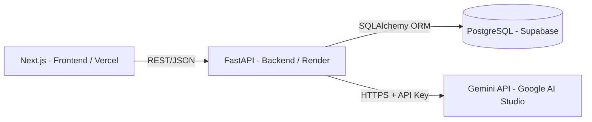

# Projeto: Chat com IA — Full Stack (Especificação Técnica)

## 1. Visão Geral

Aplicação web full stack de exemplo: login simples e um chat integrado a um LLM via API. O objetivo é servir como **projeto de referência de engenharia de software** — arquitetura em camadas bem separadas, boas práticas de Git, containerização, CI/CD e proteção de API — para depois ser usado como material didático.

**Escopo funcional (propositalmente simples):**
1. Usuário se cadastra / faz login (usuário + senha).
2. Usuário acessa uma tela de chat.
3. Usuário digita uma pergunta.
4. Backend chama o LLM externo via API e retorna a resposta.
5. (Extensão opcional, se sobrar tempo) Histórico de conversas persistido no banco.

Fora de escopo: RAG, múltiplos modelos, salas/tempo real, múltiplos usuários simultâneos.

---

## 2. Arquitetura



O frontend nunca fala diretamente com o LLM nem com o banco. Toda regra de negócio e toda credencial sensível (chave de API, string de conexão do banco) vivem no backend, em variável de ambiente — nunca no cliente, nunca commitada no repositório.

### Stack

| Camada | Tecnologia |
|---|---|
| Frontend | Next.js (App Router) |
| Comunicação | API REST (JSON) |
| Backend | FastAPI + Pydantic |
| ORM | SQLAlchemy |
| Banco de dados | PostgreSQL (hospedado no Supabase, plano free) |
| LLM | Gemini API (Google AI Studio — free tier / crédito disponível) |
| Containerização | Docker + Docker Compose |
| CI/CD | GitHub Actions |
| Testes de API | Postman / Insomnia |
| Deploy Frontend | Vercel (plano free) |
| Deploy Backend | Render (plano free) |
| Versionamento | Git + GitHub (branches, PRs) |

> **Sobre a escolha de hospedagem gratuita:** Supabase resolve o banco (Postgres gerenciado, free tier com 500MB) mas não hospeda a API FastAPI — as Edge Functions do Supabase rodam em Deno/TypeScript, não em Python. Por isso o backend fica no Render, que ainda mantém um free tier real para web services (com um detalhe importante: a instância "dorme" após ~15 min sem uso e a primeira requisição depois disso leva de 30 a 60 segundos para responder — vale explicar isso na demonstração, é um ótimo gancho para falar de cold start). Railway e Fly.io deixaram de oferecer free tier permanente em 2026.

---

## 3. Fases de execução

Ordem sequencial para a construção em uma sessão única. Cada fase termina com algo rodando e testável antes de avançar para a próxima.

### Fase 1 — Setup e contrato de API
- Criar repositório no GitHub, branch `main` protegida.
- Definir estratégia de branches (ver seção 4.1) e convenção de conventional commits (`feat:`, `fix:`, `docs:`, `chore:`...).
- Modelar o banco (tabelas `users` e `messages`).
- Definir os endpoints (`POST /login`, `POST /chat`) e montar uma coleção Postman com as requisições esperadas antes de programar (contract-first).
- **Saída:** repositório criado, README, diagrama de arquitetura, coleção Postman versionada.

### Fase 2 — Backend core
- Estrutura de pastas do FastAPI (`routers/`, `schemas/`, `models/`, `services/`).
- SQLAlchemy + PostgreSQL (local ou via Docker desde já).
- Endpoint de cadastro/login, senha com hash (bcrypt/passlib) — nunca texto puro.
- **Saída:** `POST /login` funcionando, testado no Postman.

### Fase 3 — Autenticação e testes
- JWT para sessão.
- CRUD de usuário completo.
- Testes automatizados básicos com `pytest`.
- **Saída:** fluxo de autenticação completo passando, testes rodando.

### Fase 4 — Dockerização
- Dockerfile do backend.
- `docker-compose.yml` com backend + PostgreSQL.
- `.env` para configuração, `.gitignore` cobrindo segredos desde o primeiro commit.
- **Saída:** `docker-compose up` sobe o ambiente inteiro.

### Fase 5 — Frontend
- Next.js: tela de login consumindo a API real.
- Gerenciamento de estado (Context API ou Zustand), tratamento de erro.
- Tela de chat.
- **Saída:** fluxo login → chat funcionando no navegador.

### Fase 6 — Integração com o LLM
- Endpoint `POST /chat` chamando a API do Gemini (Google AI Studio). Chave só no backend.
- Persistir pergunta e resposta associadas ao usuário logado.
- Conectar frontend ao endpoint real.
- **Saída:** chat funcional ponta a ponta.

### Fase 7 — CI/CD e Deploy
- GitHub Actions: lint + testes automáticos a cada Pull Request.
- Build automático da imagem Docker do backend.
- Deploy do frontend na Vercel, backend na plataforma escolhida.
- Variáveis de ambiente de produção configuradas fora do repositório.
- **Saída:** pipeline verde, aplicação acessível por URL pública.

### Fase 8 — Revisão final
- Checar CORS, rate limiting básico no `/chat`, nenhuma chave exposta no frontend ou no histórico do Git.
- Revisão geral do código e do README para uso didático posterior.
- **Saída:** projeto pronto para servir de material de referência.

---

## 4. Boas práticas transversais

### 4.1 Estratégia de branches

Mesmo em desenvolvimento solo, vale seguir e documentar um fluxo de branches — é justamente esse histórico que depois serve de exemplo para os alunos.

- `main` — sempre estável, protegida contra push direto; só recebe merge via Pull Request.
- `feature/<nome-da-fase-ou-tarefa>` — uma branch por fase (ex: `feature/auth-jwt`, `feature/docker-setup`, `feature/chat-llm`). Cada uma nasce da `main` atualizada e morre com o merge.
- (Opcional, mas didático) `hotfix/<descricao>` — para correções pontuais fora do fluxo normal de fases, ilustrando a diferença entre fluxo planejado e correção emergencial.
- Um Pull Request por fase, mesmo sem outro revisor: a descrição do PR referencia a fase deste documento e resume o que foi entregue. O merge só acontece com a "Saída" da fase funcionando.
- Nomenclatura curta e consistente (kebab-case), sem branches genéricas como `teste` ou `ajustes`.

- **Git:** commits pequenos e descritivos (conventional commits); idealmente todo código passa por Pull Request, mesmo em desenvolvimento solo, para deixar o histórico exemplar.
- **Segredos:** toda chave de API e credencial em variável de ambiente; `.env` no `.gitignore` desde o commit inicial.
- **API:** validação de entrada com Pydantic, status HTTP corretos, CORS restrito ao domínio do frontend.
- **Testes:** toda rota nova ganha teste antes de seguir para a próxima fase.
- **Documentação viva:** a coleção Postman é atualizada junto com a API.

---

## 5. Estrutura de pastas

```
projeto-chat-ia/
├── frontend/           # Next.js
├── backend/
│   ├── app/
│   │   ├── routers/
│   │   ├── schemas/
│   │   ├── models/
│   │   └── services/
│   ├── tests/
│   └── Dockerfile
├── docker-compose.yml
├── .github/workflows/  # CI/CD
├── postman/            # coleção exportada
└── docs/               # este .md e diagramas
```

---

## 6. Orientação para o Claude Code

Este `.md` é a fonte da verdade do projeto. Ao trabalhar sobre ele:
1. Seguir as fases na ordem, sem adiantar funcionalidades de fases futuras.
2. Criar uma branch `feature/*` por fase (seção 4.1), commits conventional, e abrir Pull Request por fase, mesmo em fluxo solo — isso vira exemplo de boas práticas para o material didático.
3. Nunca commitar chaves de API ou credenciais; usar `.env` desde a Fase 1.
4. Ao final de cada fase, garantir que a "Saída" descrita esteja de fato funcionando antes de seguir.

---

## 7. Pontos em aberto

- Definir se a extensão de histórico de conversas entra na Fase 8 ou fica apenas documentada como próximo passo (não tratado nesta versão).
